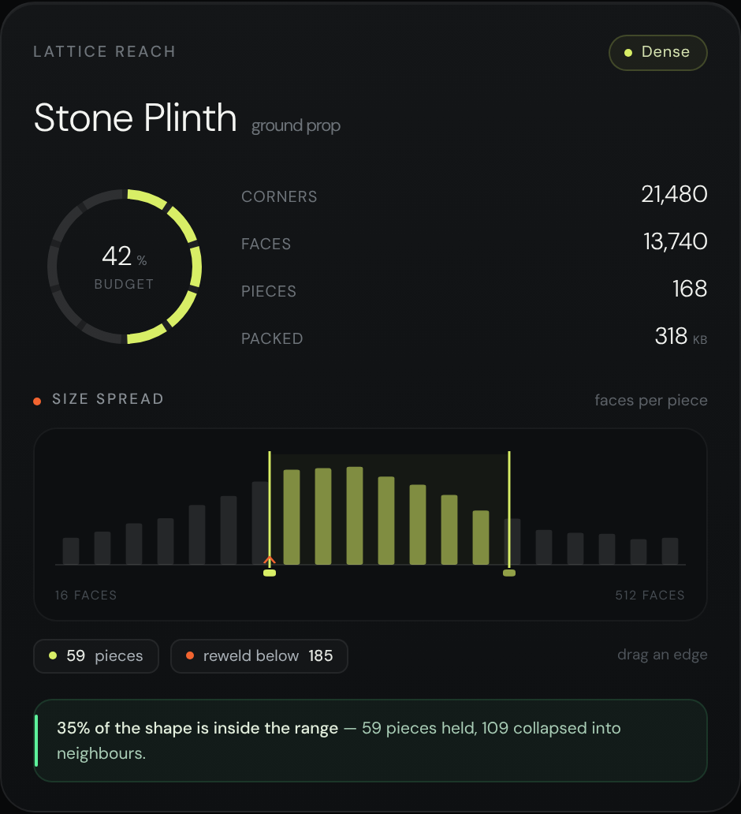

# Lattice Reach

A standalone card prototype for the `Static Mesh`, `Geometry`, and `Cluster LOD` slabs. Servable at
`http://localhost:8097/Documentation/Prototypes/LatticeReach/`.

---

## What it does

| Region | Control | Interaction |
| ------------- | ----------------- | ------------------------------------------------------------------------ |
| Head | budget arc | ten segments; the filled ones are the share of the face budget in use |
| Head | ledger | corners, faces, pieces, packed size — four readings, one column |
| Size spread | two-edge sweep | drag either edge of the distribution; the range reads as pieces held and a reweld floor |
| Size spread | callout | one sentence that changes with the range, and turns coral when the split stops paying |

---

## Deliberately small

The first draft carried three controls and a 144-cell dot field. That was too much: two of the controls
said the same thing as the ledger, and the field competed with the sweep for attention. This version
keeps one control — the sweep — and one derived warning. The arc and the ledger are read-only.

- lime appears in the arc and inside the sweep only
- coral marks the reweld marker and the callout, nothing else
- captions are symmetric (`16 faces` … `512 faces`), so neither edge reads as the whole axis
- numerals are grouped thousands, weight 300, muted decimal, small unit

---

## Renders

| File | State |
| ------------------------ | ------------------------------------------------------ |
| `renders/01-default.png` | as it opens |
| `renders/02-swept.png` | right edge pushed out, callout at 55% |

Rendered through the prototype server with `Documentation/Prototypes/_shared/capture.mjs`.
