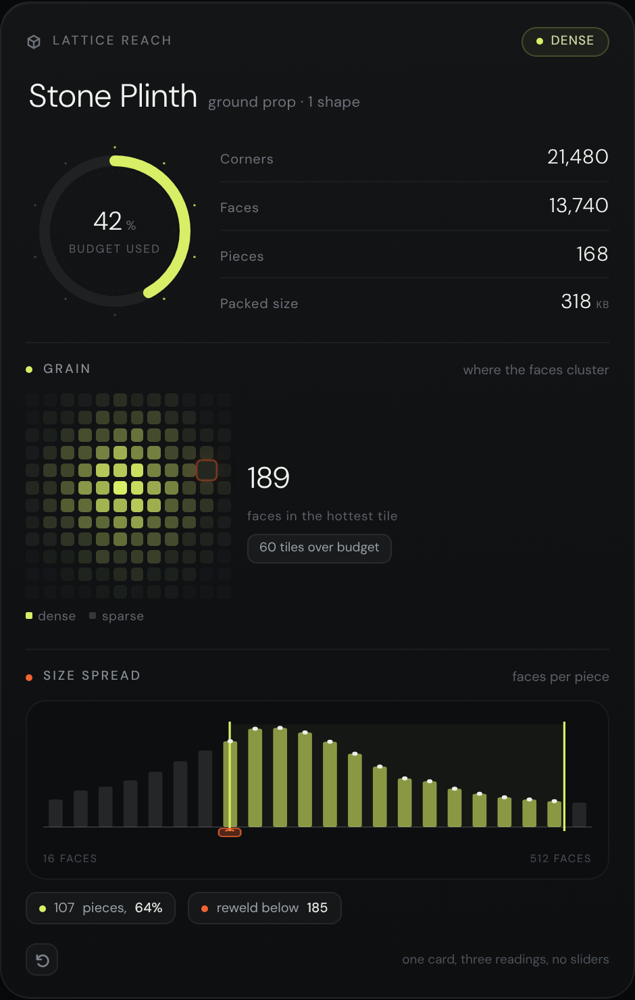

# Lattice Reach

A standalone card prototype for the three slabs the live dock calls `Static Mesh`, `Geometry`, and
`Cluster LOD`. Open `index.html` directly — no server, no network, no build step.

---

## What it does

| Region | Control | Interaction |
| ------------- | -------------------- | --------------------------------------------------------------------- |
| Head | budget arc | reads the share of the face budget the shape spends; ticks mark each tenth |
| Head | ledger | corners, faces, pieces, packed size — four readings, one column |
| Grain | dot field | hover any tile to read its face count; the hottest tile is ringed in coral |
| Size spread | two-handle sweep | drag either edge; the span reads as pieces and share, and the reweld floor follows the left edge |

There is no slider on the card. The sweep is drawn on the distribution itself, so the two handles are the
cut points rather than a position on a track.

---

## Why it looks like this

- **one accent per group** — lime for the budget and the grain field, coral only for the single ringed
  tile and the reweld marker, so coral always means "this one is over"
- **the field is the reading** — a 12 × 12 dot field shows where faces bunch up; hovering replaces a
  chart tooltip with a number that changes in place
- **the sweep is the control** — a range is set by dragging the histogram edges, and both derived numbers
  (pieces in range, reweld floor) update without a second widget
- **numerals** — grouped thousands, weight 300, muted decimal, small unit

---

## Where it would go

Replaces `Static Mesh` (the empty preview box and its two buttons), `Geometry`, and `Cluster LOD` in the
right dock. Not integrated: awaiting approval.

---

## Renders

| File | State |
| ------------------------ | ------------------------------------------------------ |
| `renders/01-default.png` | as it opens |
| `renders/02-swept.png` | sweep pushed right, a different grain tile ringed |

Rendered with the headless recipe in `Documentation/UI_REDESIGN_WORKFLOW.md`.
