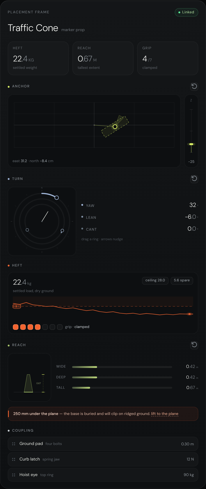

# Placement Frame

A standalone card prototype for the `Transform` and `Physics` slabs. Servable at
`http://localhost:8097/Documentation/Prototypes/PlacementFrame/`.

---

## What it does

| Region | Control | Interaction |
| -------------- | ---------------- | ------------------------------------------------------------------------ |
| Head | three stats | heft, reach, grip — read-only, the card's summary |
| Anchor | ground pad | drag the puck; arrow keys nudge, shift for coarse |
| Anchor | Z rail | drag the handle up and down |
| Turn | three-ring dial | drag near a ring to turn only that ring; arrows nudge yaw |
| Heft | sparkline | drag the ceiling line; the spare/over chip follows |
| Heft | grip dots | click a dot to set the grip, named in words under the dots |
| Reach | three bars | drag a bar to spread that axis; the figure and the numbers follow |
| Reach | callout | one sentence; turns coral and offers a one-click lift when the anchor sinks |
| Coupling | rows | drag a row by its grip to reorder |

---

## Deliberately small

The first draft had eleven controls, a slot strip, a scale track and a footnote explaining itself. This
version keeps five readings, drops the slot/scale strip, deletes the explainer, and gives every section
head the same weight. What is left is one accent per section and nothing decorative.

- pad: grid, footprint, facing wedge, puck — no labels inside the plot beyond the two deltas
- dial: three rings, each with its own zero tick, plus one needle for facing
- heft: one trend line, one draggable ceiling, one live dot
- reach: three bars and a silhouette sharing one scale

---

## Renders

| File | State |
| ------------------------ | ------------------------------------------------------ |
| `renders/01-default.png` | as it opens |
| `renders/02-engaged.png` | pad moved, yaw turned, wide spread, ceiling lowered, grip bolted |
| `renders/03-warning.png` | anchor 250 mm under the plane, callout coral, inline lift offered |

Rendered through the prototype server with `Documentation/Prototypes/_shared/capture.mjs`.
