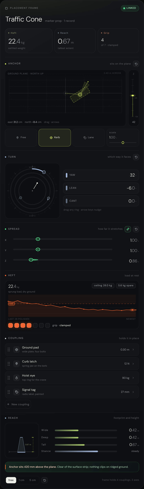

# Placement Frame

A standalone card prototype for the block the live dock calls `Transform`, plus the `Physics` slab under
it. Open `index.html` directly — no server, no network, no build step.

---

## What it does

| Region | Control | Interaction |
| -------------- | --------------------------- | ---------------------------------------------------------------------- |
| Anchor | ground pad | drag the puck across the plane; arrow keys nudge, shift for coarse |
| Anchor | Z rail | drag the handle up and down; the readout and the callout follow |
| Anchor | slot row | pick which named place on the world the frame claims |
| Anchor | scale track | drag; the reach readings and the silhouette follow |
| Turn | three-ring dial | drag near a ring to edit only that ring; arrow keys nudge |
| Spread | three bands | drag a band; the link button ties all three together |
| Heft | sparkline | drag the ceiling line; the spare/over chip and the curtain follow |
| Heft | grip dots | click a dot to set the grip level, named in words |
| Coupling | rows | drag a row by its grip to reorder; the dashed slot adds one |
| Reach | silhouette + bars | reads the authored size times spread; the stance word follows |
| Footer | snap steps | free, 1 cm, 5 cm — the pad and the rail honour the step |

The callout under Reach is live: sink the anchor below the plane and it turns coral, names the buried
depth in millimetres, and offers a one-click fix.

---

## Why it looks like this

The reference set in `SourceImages/General UI/` is a matte obsidian bento layout with weight-300 numerals
split at the decimal, one accent per group, and infographics that are themselves the control. This card
takes that language and applies it to placement:

- **accent per section** — lime for anchor, slate for turn, mint for spread, coral for heft, steel for
  reach; no section has two accents
- **no sliders** — every value is dragged on a picture of what it changes: a pad, a ring, a band, a curve
- **numerals** — split integer and muted decimal, unit at half the numeral size
- **no prose** — one sentence in the callout, nothing else written on the card

---

## Where it would go

Replaces the `Transform` slab and the `Physics` slab in the right dock of `Experimental/ComponentViewer/`.
Not integrated: awaiting approval.

---

## Renders

| File | State |
| ------------------------ | ------------------------------------------------------ |
| `renders/00-full-card.png` | the whole card in one frame |
| `renders/01-default.png` | as it opens |
| `renders/02-engaged.png` | pad moved, yaw turned, spread pushed, ceiling lowered, grip raised, slot changed |
| `renders/03-warning.png` | anchor sunk below the plane, callout in its warning state |

Rendered with the headless recipe in `Documentation/UI_REDESIGN_WORKFLOW.md`.
