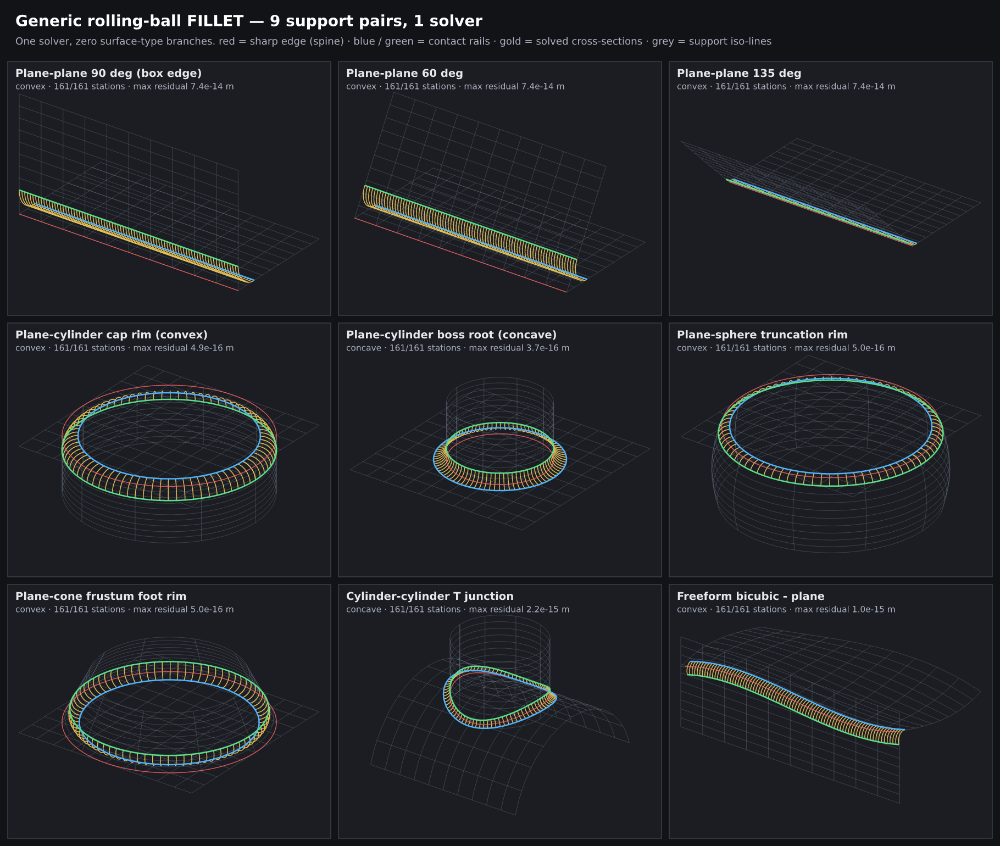
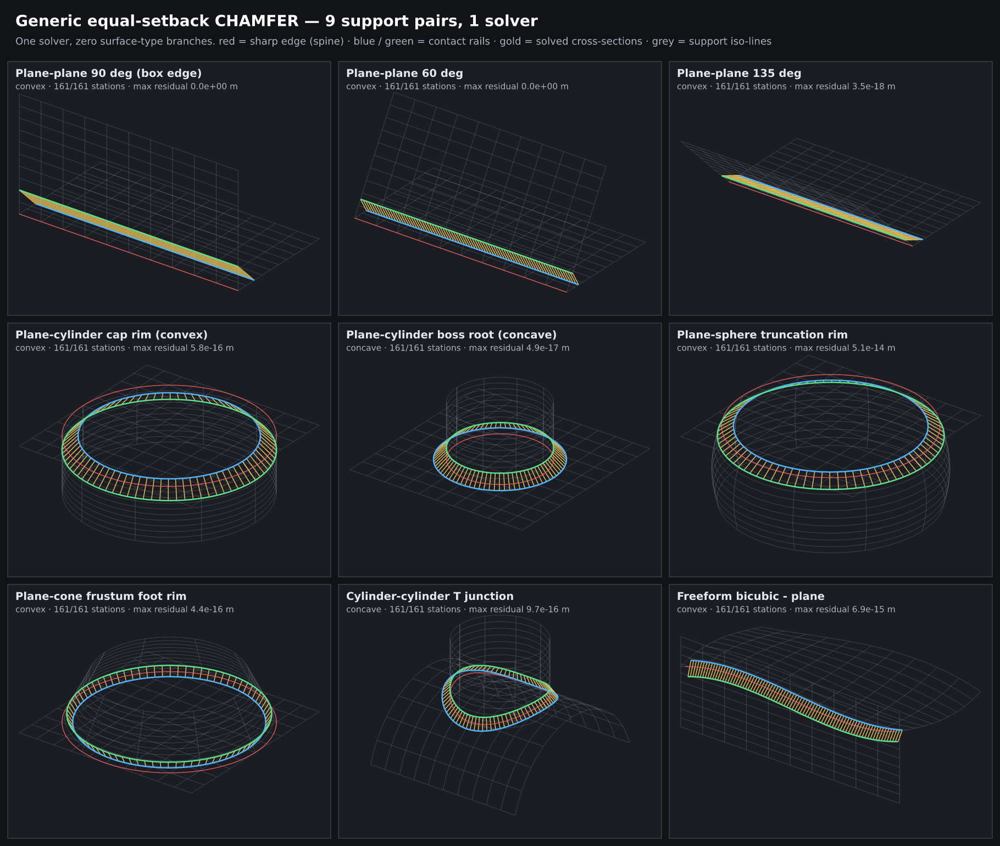
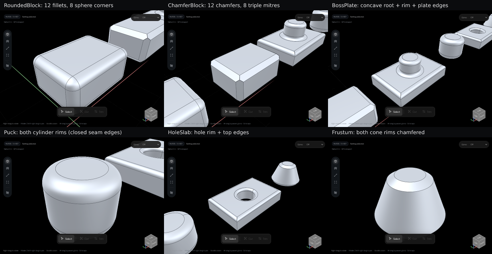

# Rolling-Ball Blend Validation

One surface-agnostic cross-section solver (fillet + chamfer) marched along nine support pairs.
The construction code never reads a surface classification; closed forms are used only to verify.

## Result

| Profile | Specimens | Stations | Converged | Worst residual | Worst closed-form deviation | Status |
|---------|-----------|----------|-----------|----------------|-----------------------------|--------|
| Fillet  | 9         | 1,449    | 1,449     | 7.4e-14 m      | 1.2e-12 m                   | 🟢     |
| Chamfer | 9         | 1,449    | 1,449     | 5.1e-14 m      | 1.1e-12 m                   | 🟢     |

Full per-specimen table: [Results/RollingBallStationResults.md](Results/RollingBallStationResults.md).




## Stage 2: kernel integration, proven in the SolidArc editor

`Experimental/SolidArc/Service/Kernel/RollingBallBlend.{h,cpp}` builds the blend on real B-rep topology (imprint-and-replace,
no booleans) and is the default `beveladd` route; the legacy `BlendSolver` remains only as a fallback.

| Evidence | Result | File |
|---|---|---|
| 15 B-rep specimens (13 closed-form volumes + 2 required refusals) | 15 / 15 🟢 (12 exact closed forms, err ≤ 2.3e-5) | [Results/RollingBallBlendHarness.md](Results/RollingBallBlendHarness.md) |
| Kernel corrections + editor test suites | 4 defects fixed · `test:bevel` 71 / 71 | [Results/BevelLabEditorProof.md](Results/BevelLabEditorProof.md) |
| Live editor scene, general vs legacy | 6 / 6 vs 1 / 6 | [Results/BevelLabEditorProof.md](Results/BevelLabEditorProof.md) |
| Editor latency after host fixes | idle frame 1,050 ms → 9 ms | [Results/BevelLabEditorProof.md](Results/BevelLabEditorProof.md) |



## Verification columns

| Column             | Meaning                                                                         |
|--------------------|---------------------------------------------------------------------------------|
| Residual           | Norm of the four station equations after Newton.                                 |
| Ball / setback dev | Fillet: abs(\|c − pᵢ\| − r). Chamfer: abs(\|pᵢ − e\| − d).                       |
| Normal dev         | Angle between (c − pᵢ) and the inward/outward support normal.                     |
| Independent dev    | Exact distance from c to each infinite support, minus r (separate code path).     |
| Closed-form dev    | Distance from the solved centre/contact to the textbook analytic answer.          |

Closed-form deviations of ~1e-12 m come from the central-difference spine tangent (h = 1e-6), not the solver.

## Reproduce

```sh
g++ -std=c++20 -O2 -Wall -Wextra -o _ClaudeScratch/build/RollingBallStationValidation \
    Exhibits/RollingBallBlend/Code/RollingBallStationValidation.cpp
_ClaudeScratch/build/RollingBallStationValidation Exhibits/RollingBallBlend/Results
# SVG → PNG (scratch-only tool): npm i @resvg/resvg-js@2.6.2, then render the two *Sheet.svg files.
```

| Item       | Value                                                      |
|------------|------------------------------------------------------------|
| Platform   | Linux x86-64 sandbox (Debian 12)                           |
| Compiler   | g++ 12.2.0, `-std=c++20 -O2`, zero warnings                |
| Runtime    | 1.8 s for 18 specimens × 161 stations                      |
| Revision   | Uncommitted work on `arena/d90f0539-frontier`              |
| Windows    | Not run. The code is portable standard C++20 with no dependencies. |

## Limits

- 🚧 This shows that the **cross-section solve and walk** are type-agnostic. Imprinting, end capping,
  corner patches, NURBS strip fitting and B-rep assembly are not implemented here.
- Specimens give the into-face direction at the first station by hand; a B-rep derives it from coedge sense.
- No radius-too-large or support-hop events are exercised yet.
- Generated SVGs are written to `Results/` and can be regenerated; only the PNGs are retained as images.
