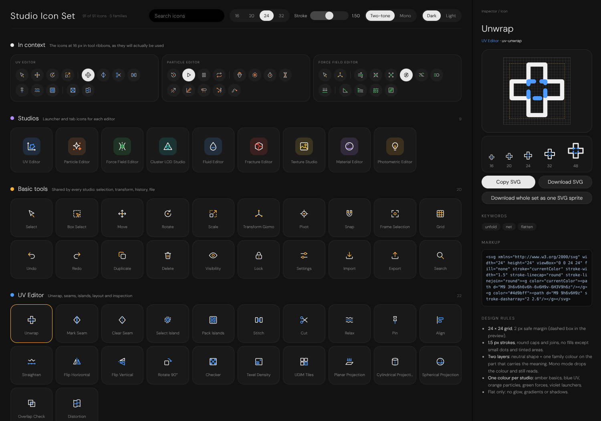

# Studio Icon Set (`Experimental/StudioIconSet`)

> 91 original SVG icons for the Frontier studios: launchers, shared basic tools, UV Workspace, Particle Editor and
> Force Field Editor. One self-contained page, no dependencies.



```bash
python3 -m http.server 8094 --bind 0.0.0.0 -d Experimental/StudioIconSet
```

| Family | Count | Colour | Covers |
| :--- | ---: | :--- | :--- |
| Studios | 9 | per studio | Launcher / tab icons: UV, Particle, Force Field, Cluster LOD, Fluid, Fracture, Texture, Material, Photometric |
| Basic tools | 20 | amber | Select, box select, move, rotate, scale, gizmo, pivot, snap, frame, grid, undo/redo, duplicate, delete, visibility, lock, settings, import/export, search |
| UV Workspace | 22 | blue | Unwrap, seams, island select, pack, stitch, cut, relax, pin, align, straighten, flips, rotate, checker, texel density, UDIM, projections, overlap, distortion |
| Particle Editor | 23 | orange | Emitter shapes, burst, rate, lifetime, velocity, size/colour over life, gravity, collision, trail, sprite, sub-emitter, turbulence, curve, playback |
| Force Field Editor | 17 | green | Wind, attractor, repulsor, vortex, turbulence, drag, gravity, point, curve guide, magnetic, falloff, range, strength, streamlines, vector grid, heatmap, obstacle |

**Rules:** 24 x 24 grid, 2 px safe margin, 1.5 px round strokes, flat (no glow or gradients). Each icon has a neutral
layer and one accent layer in the family colour; Mono mode drops the colour. Colour mode makes every icon two colours: the base layer takes a contrasting hue per family (gold, sky or pink) and the accent keeps the family colour, with plain tiles.

**Page:** search, size (16-32), stroke weight, two-tone / mono, dark / light stage, an "in context" strip showing the
icons at 16 px in tool ribbons, and an inspector with pixel-grid preview, size ladder, Copy SVG, Download SVG and a
whole-set sprite download (`<use href="frontier-studio-icons.svg#uv-unwrap"/>`).

Icon data lives in `IconDefinitions.js` (`FAMILIES`, `ICONS`) so other studios can import it directly.
Fonts: DM Sans, SIL Open Font License (`Fonts/OFL.txt`).
